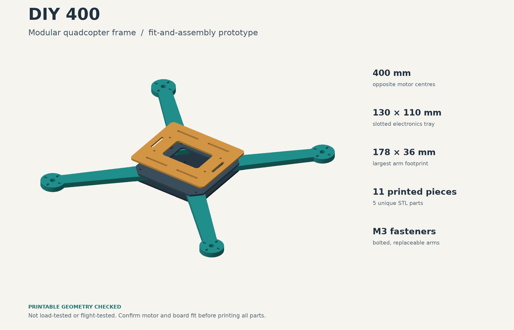

# FPGA-assisted DIY quadcopter

A DIY aircraft project combining a printable frame, a Rust ground station for PS4 input, and a bounded C++ optical-flow kernel intended for a future onboard FPGA. PX4 is the planned flight controller; the FPGA would process camera motion for assisted hovering.

**Current stage: desktop software and a printable frame prototype.** The aircraft has not been assembled or flown. FPGA synthesis, physical controller validation, and PX4 SITL are still pending.



## What is here

| Component | Implemented | Still to validate or build |
|---|---|---|
| [Ground station](groundstation/README.md) · Rust | CSV command replay, optional gamepad input, deadman/freshness checks, opt-in localhost MAVLink, telemetry logging | Physical PS4 mapping, PX4 SITL, aircraft link |
| [Vision](vision/README.md) · C++17 | Allocation-free integer block matcher, separate reference, PGM-to-flow CLI, invalid-measurement handling | Noisy search-edge motion, camera integration, HLS port and FPGA deployment |
| [Simulation fixtures](simulation/README.md) · C++17 | Deterministic images/commands, malformed-input fixtures, timestamp-aligned flow evaluation | Flight dynamics and closed-loop simulation |
| [Printable frame](hardware/printable-frame/README.md) · Python/CAD | 400 mm modular frame, six STL files, assembly preview, mesh validation | Print/fit/strength testing, hardware-specific mounts, landing gear |

The software pipeline today is **synthetic fixtures → vision estimates → evaluation**, alongside command replay. Pixel displacement is an image measurement, not aircraft velocity or a flight command.

## Quick start

Requirements: macOS or Linux, a C++17 compiler, CMake 3.16+, Python 3.9+, and Rust 1.98.1 with `rustfmt` and `clippy`. Python uses only its standard library for software checks. Rust dependencies are locked in `groundstation/Cargo.lock`.

From the repository root:

```sh
python3 scripts/check.py
```

This builds both C++ components with vision sanitizers enabled, runs their tests, checks Rust formatting/lints/tests, and exercises all seven integration scenarios. Each run saves fixtures, flow estimates, command replay, evaluation reports, and `summary.json` under a new `build/integration/run-*` directory. Unit tests use ephemeral localhost UDP ports; the integration demo is offline and needs no controller, FPGA, or simulator.

To also compile and test the optional gamepad support:

```sh
python3 scripts/check.py --gamepad
```

Linux gamepad support requires `pkg-config` and `libudev` development files (`pkg-config libudev-dev` on Ubuntu). No physical pad is needed for these host tests. See the [ground-station guide](groundstation/README.md) for the explicitly enabled localhost demo.

**Known failure:** the `image_noise` fixture measures only 2/6 valid motions because four noisy ±8 px shifts are rejected. The check script reports this as `KNOWN LIMITATION` and verifies its exact current outcome. Any other failure fails the check. Use `--strict-noise` to also make that known limitation fail the command. A passing CI run does not mean every motion scenario succeeds. See [verification results](docs/verification.md).

GitHub Actions runs `scripts/check.py --gamepad` on Ubuntu and macOS and saves the integration reports as artifacts.

## Printable frame

- [Download the STL package](hardware/printable-frame/DIY_400_quadcopter_STLs.zip) or browse the [individual STLs](hardware/printable-frame/stl/).
- Follow the [print quantities, dimensions, and assembly guide](hardware/printable-frame/README.md).
- The [parametric source](hardware/printable-frame/generate_frame.py) can regenerate the parts; its separate Python dependencies are listed beside it.

The parts fit a 220 × 220 mm bed. Mesh checks cover geometry, not strength or flightworthiness. Motors, battery, flight controller, FPGA, and camera have not been selected.

## Roadmap

1. Complete physical PS4 and PX4 SITL checks, and address the noisy-motion limitation.
2. Select a compatible DIY bill of materials and finish hardware-specific CAD.
3. Print, inspect, assemble, and establish manual flight.
4. Port the vision kernel to the chosen FPGA and record calibrated onboard measurements.
5. Integrate validated flow/range measurements with PX4 for assisted hovering.

Read the [phase plan](PLAN.md), [complete aircraft scope and budget assumptions](SCOPE.md), and [shared CSV/data contracts](docs/interfaces.md). This project is separate from the CanSat flight-stage tracker.
