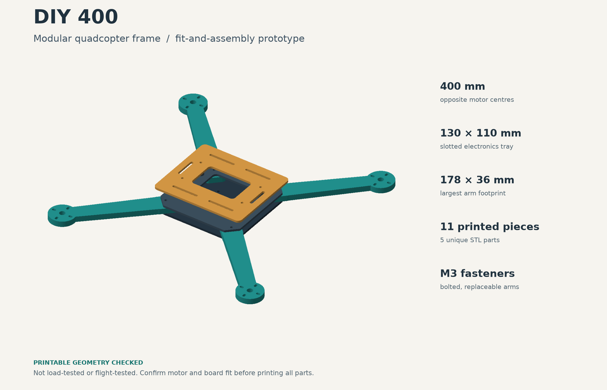

# FPGA-assisted DIY quadcopter

A DIY aircraft project combining a printable frame, a Rust ground station, a
bounded C++ optical-flow kernel, and Python neural motion forecasting. PX4 is
the planned flight controller. FPGA processing of vision and neural inference
remains a future deployment target.

**Current stage: desktop software and a printable frame prototype.** The aircraft has not been assembled or flown. FPGA synthesis, physical controller validation, and PX4 SITL are still pending.



## What is here

| Component | Implemented | Still to validate or build |
|---|---|---|
| [Ground station](groundstation/README.md) · Rust | CSV command replay, optional gamepad input, deadman/freshness checks, opt-in localhost MAVLink, telemetry logging, neural forecast capture and path dashboard | Physical PS4 mapping, PX4 SITL, aircraft link |
| [Neural forecasting](nn/README.md) · Python/Keras/PyTorch | Imported training and evaluation code, saved local rate models, trajectory architecture, JSONL prediction export and a trained synthetic trajectory demo | Real-flight trajectory training, onboard integration, hls4ml conversion and FPGA execution |
| [Vision](vision/README.md) · C++17 | Allocation-free integer block matcher, separate reference, PGM-to-flow CLI, invalid-measurement handling | Noisy search-edge motion, camera integration, HLS port and FPGA deployment |
| [Simulation fixtures](simulation/README.md) · C++17 | Deterministic images/commands, malformed-input fixtures, timestamp-aligned flow evaluation | Flight dynamics and closed-loop simulation |
| [Printable frame](hardware/printable-frame/README.md) · Python/CAD | 400 mm modular frame, six STL files, assembly preview, mesh validation | Print/fit/strength testing, hardware-specific mounts, landing gear |

The software pipelines today are **synthetic images → vision estimates →
evaluation** and **flight/state logs → neural forecasts → Rust capture and
dashboard**, alongside command replay. Pixel displacement is an image
measurement, not aircraft velocity or a flight command. The dashboard separates
the intended route from predicted motion; neither is connected to aircraft
control.

## Quick start

Requirements: macOS or Linux, a C++17 compiler, CMake 3.16+, Python 3.9+, and Rust 1.98.1 with `rustfmt` and `clippy`. Python uses only its standard library for software checks. Rust dependencies are locked in `groundstation/Cargo.lock`.

From the repository root:

```sh
python3 scripts/check.py
```

This builds both C++ components with vision sanitizers enabled, runs their tests, checks Rust formatting/lints/tests, and exercises all seven integration scenarios. Each run saves fixtures, flow estimates, command replay, evaluation reports, and `summary.json` under a new `build/integration/run-*` directory. Unit tests use ephemeral localhost UDP ports; the integration demo is offline and needs no controller, FPGA, or simulator.

To also compile and test the optional gamepad support:

```sh
python3 scripts/check.py --gamepad
```

Linux gamepad support requires `pkg-config` and `libudev` development files (`pkg-config libudev-dev` on Ubuntu). No physical pad is needed for these host tests. See the [ground-station guide](groundstation/README.md) for the explicitly enabled localhost demo.

**Known failure:** the `image_noise` fixture measures only 2/6 valid motions because four noisy ±8 px shifts are rejected. The check script reports this as `KNOWN LIMITATION` and verifies its exact current outcome. Any other failure fails the check. Use `--strict-noise` to also make that known limitation fail the command. A passing CI run does not mean every motion scenario succeeds. See [verification results](docs/verification.md).

GitHub Actions runs `scripts/check.py --gamepad` on Ubuntu and macOS and saves the integration reports as artifacts.

## Neural predictions and path display

The neural component was consolidated from the existing local
`Quadcopter-Neural-Network` project. The original directory is preserved. Local
datasets, weights and results are under `nn/` and ignored by Git; fresh checkouts
can generate the self-contained synthetic demonstration without downloading
flight data.

Install the optional neural dependencies in a project virtual environment:

```sh
python3.12 -m venv .venv
.venv/bin/python -m pip install -r requirements-neural.txt
.venv/bin/python -m nn groundstation-demo --output build/neural-demo
cargo run --manifest-path groundstation/Cargo.toml -- predictions \
  --input build/neural-demo/predictions.jsonl \
  --capture build/neural-capture.jsonl \
  --dashboard build/neural-dashboard.html
```

Open `build/neural-dashboard.html` for interactive replay. Output paths must be
new. The demo actually trains a trajectory model on analytic software fixtures
and shows its predictions, its planned-route inputs and observed fixture
positions separately. It is labelled synthetic throughout; it is not a flight
simulation or evidence of real-aircraft trajectory accuracy.

For a live, read-only display, start this explicitly enabled loopback listener:

```sh
.venv/bin/python -m nn groundstation-export \
  --model build/neural-demo/model --input build/neural-demo/input.csv \
  --metadata build/neural-demo/input.metadata.json \
  --source-kind software_fixture --output - --pace | \
  cargo run --manifest-path groundstation/Cargo.toml -- predictions \
  --input - --capture build/live-neural-capture.jsonl \
  --dashboard build/live-neural-replay.html --serve 127.0.0.1:8080
```

Visit `http://127.0.0.1:8080`. The display clears current predictions on invalid
input, stalled receipt or disconnection; recorded replay stays available. This
command does not arm, take off, send setpoints or connect to a vehicle.

The existing saved IDSIA model predicts body rates only, so it can be captured
and inspected but cannot supply a position path. Real trajectory inference
requires position, velocity, attitude and a route known at prediction time, plus
a model trained for those outputs. See [the forecasting contract](nn/FORECASTING.md)
and [the Python/Rust telemetry interface](docs/predictions.md).

Run the full optional neural check with the same virtual environment:

```sh
.venv/bin/python scripts/check.py --neural
```

It runs the existing host checks, neural tests, fresh fixture-model training,
Python prediction export, Rust capture and dashboard generation. Add
`--gamepad` to test optional controller support too.

## Roadmap

1. Complete physical PS4 and PX4 SITL checks, and address the noisy-motion limitation.
2. Select a compatible DIY bill of materials and finish hardware-specific CAD.
3. Print, inspect, assemble, and establish manual flight.
4. Port the vision kernel to the chosen FPGA and record calibrated onboard measurements.
5. Integrate validated flow/range measurements with PX4 for assisted hovering.

Read the [phase plan](PLAN.md), [complete aircraft scope and budget assumptions](SCOPE.md), and [shared CSV/data contracts](docs/interfaces.md). This project is separate from the CanSat flight-stage tracker.
