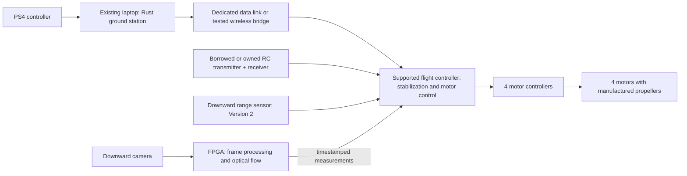

# DIY FPGA quadcopter — complete project scope

Updated: 2026-10-12

This is the current product scope. It supersedes the original X500 development-kit purchasing plan. The existing software and printed-frame prototype remain useful starting points; they are not a completed aircraft.

## 1. Finished outcome

Build a small outdoor quadcopter with a mostly 3D-printed structure, a PS4-controlled ground station, an established flight controller, and an onboard FPGA that processes a downward camera. Demonstrate manual flight first, onboard vision measurements second, and short-duration assisted hovering last.

### Version 1: manual flight plus onboard FPGA processing

- An assembled, serviceable aircraft with replaceable arms, secured electronics, and a secured battery.
- Stable manual flight using a dedicated RC link for initial setup and takeover, followed by a tested PS4-to-ground-station command path.
- An onboard camera feeding a real FPGA optical-flow pipeline. Its estimates are recorded without controlling the aircraft initially.
- Logs of input commands, flight-controller telemetry, camera/flow timing, and sensor validity.
- A reproducible demonstration and documented bill of materials, wiring, assembly, firmware, and test results.

### Version 2: assisted hovering

- Add range sensing and synchronized attitude/gyro information as needed by the chosen estimator interface.
- Convert camera output into correctly calibrated flight-controller measurements.
- Demonstrate short-duration vision-assisted hovering over a textured surface in adequate lighting.
- Establish and measure the operating envelope. Optical flow is not drift-free absolute positioning.

### Later extensions

Automatic takeoff/hover/land is a separate milestone after reliable assisted hold. Neural networks, obstacle avoidance, GPS missions, outdoor autonomous navigation, custom motor controllers, and an FPGA-only flight controller are not required for Versions 1–2.

## 2. Architecture

The PS4 connects to the laptop over USB initially. Its Bluetooth range is not the aircraft link. An RC receiver alone does not provide the laptop-to-flight-controller data path. Both paths need explicit hardware and configuration.

The flight controller closes the stabilization loop. The FPGA is initially a measurement processor. Loss of FPGA data must not leave the stabilization loop dependent on stale estimates. The existing localhost-only software must be extended and tested before it can command an aircraft over a physical link.

PX4 is the current software baseline. Select a board explicitly supported by the firmware release being used; an arbitrary inexpensive flight controller is not automatically compatible. If that cannot fit the budget, evaluate a supported alternative such as ArduPilot as an explicit scope change, including mode, message, parameter, and simulator tests. Do not assume the current PX4 mapping is portable without validation.

## 3. Cost and assumptions

All amounts are **CAD planning allowances before tax and shipping**, not current shop quotations. The FPGA board itself is excluded. An existing laptop, printer access, basic tools, and a PS4 controller are assumed. Do not purchase against this table until exact component compatibility is checked.

| Item | Quantity | Low | High | Needed for |
|---|---:|---:|---:|---|
| Filament, frame fasteners, basic mounts | One set | $20 | $40 | V1 |
| Matched motors, ESCs, propellers, basic propeller spares | Four motor/ESC sets | $80 | $130 | V1 |
| Supported flight controller with onboard IMU | 1 | $45 | $80 | V1; price/support must be confirmed |
| Flight battery | 1 | $35 | $55 | V1 |
| Power distribution, FPGA regulator, connectors, wiring | One set | $20 | $40 | V1 |
| Low-cost ground-to-air data bridge | One link | $15 | $30 | V1; engineering allowance, not a validated radio selection |
| Balance charger | 1 | $35 | $60 | V1; borrow if available |
| RC transmitter and compatible receiver | One set | $80 | $130 | V1; borrow if available |
| Basic camera and connection hardware | 1 | $20 | $40 | V1; assumes a compatible low-cost camera interface |
| Downward range sensor | 1 | $20 | $40 | V2 |
| **V1 total, buying all listed V1 items** | | **$350** | **$605** | Excludes FPGA |
| **V1 + V2 total, buying everything** | | **$370** | **$645** | Excludes FPGA |
| **V1 with radio set and charger borrowed** | | **$235** | **$415** | Excludes FPGA |
| **V1 + V2 with radio set and charger borrowed** | | **$255** | **$455** | Excludes FPGA |

The low-cost data bridge requires implementation and real link tests; it is not equivalent to a proven long-range telemetry system. A ready-made telemetry radio, a vendor camera carrier, or a more expensive supported flight controller can exceed these allowances. Recalculate before selecting those parts. Spare batteries, crash replacements, a printer/computer purchase, a dedicated test stand, and any paid software licenses are not included. Confirm the chosen FPGA device/tool flow is usable without a paid license before committing.

If the budget beyond the FPGA is below roughly $150, a free-flying quadcopter is not a credible new-parts scope. Deliver a camera/FPGA bench demonstrator or a balancing rig first, and retain the aircraft as a later expansion. The firm user budget is still unconfirmed.

## 4. Complete mechanical package

The current DIY 400 geometry is provisional. The final footprint depends on actual propulsion, FPGA mass, power, and the printer/material.

| Deliverable | Current state | Work required |
|---|---|---|
| Lower central plate | STL prototype exists | Match controller, battery retention, wiring, fastener access |
| Upper arm clamp | STL prototype exists | Verify root stiffness, clamp bearing, and printed tolerances |
| Four replaceable arms and motor pads | STL prototype exists | Match actual motor pattern and screw engagement; assess flex and vibration |
| FPGA tray and spacers | Generic STL prototype exists | Add board-specific insulating standoffs, connector clearance, and cooling space |
| Landing gear | Missing | Provide propeller/body clearance, stable stance, camera protection, and battery clearance |
| Downward camera mount | Missing | Set known orientation, preserve field of view, secure cable, and allow calibration |
| Range-sensor mount | Missing | Align measurement direction and prevent occlusion; V2 |
| Battery cradle and strap guides | Strap slots only | Match selected pack and restrain it in all axes; retain access for removal |
| Electronics cover and cable retention | Missing | Ventilation, fastener access, antenna placement, strain relief |
| Assembly and service instructions | Partial | Exploded model, hardware lengths/counts, wiring routes, replacement instructions |
| Final print release | Missing | Separate STLs, editable source, print orientations, fit coupons, measured print mass |

Propellers, motors, ESCs, battery, sensors, and electronics are purchased components. Printed propellers are excluded. Propeller guards are an optional separately assessed accessory because they add weight and can deflect into the propeller envelope; the existing frame has none.

The current model has a 400 mm motor diagonal and a full-density CAD estimate of about 309 g of PETG, excluding fasteners/electronics. That is not the actual slicer or printed weight, but it is enough to make mass reduction a design task. The present arms are not frozen as the final flight structure. If printed arms cannot meet the measured stiffness/weight needs, use a documented hybrid revision with printed joints and rigid arms.

Before freezing propulsion, make an all-up mass ledger including printed parts, FPGA, controller, ESCs, motors, wiring, camera, battery, and fasteners. Choose a matched motor/propeller/voltage combination using real data; aim for combined static thrust around twice finished weight as an initial design margin. This does not replace structural or flight testing. Battery, ESC, connector, and regulator ratings follow the measured current and voltage requirements.

## 5. Software and FPGA work packages

### 5.1 Ground station — Rust

Existing: offline command replay, mapping and deadzone logic, optional gamepad input, localhost MAVLink MANUAL_CONTROL, input freshness, enable/deadman gating, basic telemetry logs, and host tests.

Remaining:
- Verify the physical DualShock 4 mapping and reconnect behavior.
- Run an actual supported PX4 SITL instance; test modes, neutral-input interpretation, authority, link interruption, and stale commands.
- Add an explicit physical-link configuration without weakening the default offline behavior.
- Implement the selected bridge/transport, receiver handling, and reconnect policy. Validate command age, loss, duplication, and delayed packets.
- Add useful live readouts: connection state, input enable, battery status where available, attitude, and flow validity. A simple terminal display is sufficient for V1.
- Make long-running recording useful during a run, with defined flush behavior and recoverable logs; do not depend only on clean process exit.
- Document the relationship between PS4 commands, RC takeover, flight mode, and autopilot loss behavior.

### 5.2 Vision — C++ reference and FPGA kernel

Existing: PGM sequence processing, bounded integer block matching, validity output, an allocation-free processing core, host tests, and synthetic reference comparisons.

Remaining:
- Resolve or bound the noisy-search-edge limitation: the integrated image_noise test rejected four of six noisy movements at the ±8 px search boundary.
- Preserve conservative rejection of ambiguity and out-of-range movement. Do not make the benchmark pass by removing failing rows or disabling validity checks.
- Add camera capture, a clearly defined grayscale/crop/downsample path, frame buffering, timestamps, and dropped-frame handling.
- Create the selected board's HLS project, interfaces, implementation constraints, build instructions, and bitstream flow. Add HDL glue where required.
- Compare host results, HLS simulation/co-simulation where available, and actual FPGA outputs.
- Measure actual board power, processing time, memory use, and resource utilization.
- Define an initial target of 64 × 64 grayscale at 30 frame pairs/second, with processing keeping up without unbounded backlog. This is a provisional engineering target, not measured performance; revise with the selected hardware.

### 5.3 Sensor and flight-controller integration

Remaining:
- Choose the camera/FPGA/flight-controller electrical interfaces and IO voltage levels.
- Design a regulated power tree with the FPGA board's real input/current requirements. Do not power it from an unverified flight-controller rail.
- Define a timestamped measurement packet with validity, interval, sequence, and integrity handling. Keep this distinct from the existing offline pixel CSV.
- Calibrate camera intrinsics and mounting orientation.
- Match gyro/attitude and range measurements to the image exposure interval as required by the selected estimator path.
- Implement the chosen PX4 optical-flow message/driver path with documented units and quality handling. A valid pixel displacement alone is not a valid aircraft velocity measurement.
- Establish estimator validity and mode-exit behavior when optical flow or range becomes unavailable.

### 5.4 Simulation, replay, and evaluation

Existing: deterministic image/command fixtures, corruption scenarios, replay evaluation, and PX4 setup notes. This is not a flight-dynamics simulator.

Remaining:
- Turn the independently executed integration sequence into a repeatable project-level command.
- Add noisy boundary cases, camera-rate drops, sensor timing offsets, and appropriate recorded camera sequences.
- Run real SITL for the selected autopilot version; record the version and configuration.
- Keep offline image metrics, software-loopback metrics, simulator results, hardware measurements, and flight results separate in reports.
- Add a hardware-in-the-loop bench step after the board and physical link exist.

## 6. Build phases and completion gates

| Phase | Hardware work | Software work | Done when |
|---|---|---|---|
| 1. Freeze interfaces and budget | Identify actual FPGA, controller, camera, printer, power, and propulsion candidates | Confirm toolchain/device support and chosen autopilot baseline | A compatible itemized BOM, mass/power estimate, and wiring draft exist within the spending cap |
| 2. Complete desk demo | PS4 on USB; FPGA/camera bench setup once selected | Fix/bound vision issue, run SITL, implement camera/HLS path | Real controller works in simulation and actual FPGA output is compared with the reference |
| 3. Finalize print package | Fit coupons, one arm, final mounts, landing gear, full frame | Regenerate CAD and document assembly | Selected hardware fits, measured mass is recorded, and structural checks support proceeding |
| 4. Assemble electronics | Power distribution, controller, ESCs, motors, links, battery | Configure firmware and test actual transport and logging | Propellers-off checks pass, rails remain stable, directions/mapping are confirmed, and link interruption behaves as configured |
| 5. Establish manual flight | Completed aircraft, initially without optional FPGA payload if needed | Tune established autopilot and gather logs | Repeatable takeoff, manual hover, and landing through RC; then validate PS4 control with an independent takeover path |
| 6. Fly with FPGA measurements | Add secured FPGA/camera, verify power and balance | Record synchronized measurements without using them for control | Actual flight logs demonstrate understood validity, latency, vibration, and lighting limits |
| 7. Demonstrate assisted hover | Add/verify range sensing and sensor mounts | Calibrated estimator integration and mode/loss behavior | Repeatable short assisted hovering with measured drift, validity, and takeover behavior |

Phases 2 and 3 can overlap after Phase 1 freezes their interfaces. Manual flight and FPGA bench work can progress separately. Never make a hardware claim solely because a synthetic or loopback test passed.

For an initial planning envelope, allow roughly 6–12 weeks of part-time work after compatible parts are available if the basic tools are familiar. A first FPGA/HLS or first multirotor build can take longer. This is an estimate, not a schedule commitment; board choice and hands-on experience are unresolved.

## 7. Acceptance evidence

- **Mechanical:** actual part dimensions and mass; fastener and motor fit; recorded arm/joint deflection and inspection under the selected load case; vibration data from the controller. Define the load case from selected propulsion before testing.
- **Electrical:** battery and regulated-rail measurements; current/temperature checks under representative loads; no unexplained resets.
- **Commands:** measured signs/ranges; neutral and enable behavior; observed stale-input handling; configured independent control/takeover and link-loss tests.
- **FPGA:** synthesis/implementation reports, a deployed bitstream, reference comparisons, timestamped throughput/latency and actual power measurements.
- **Vision:** error and valid coverage on held-out recorded scenes, explicitly including texture loss, noise, motion near the search limit, and frame drops.
- **Flight:** manual-flight logs before enabling FPGA-derived control; assisted-hover logs with stated test conditions and observed drift. No claim of obstacle avoidance or general autonomous navigation.

## 8. Current inventory and missing decisions

Delivered: three software components, their documentation/tests, coordinator integration results, and a generic modular STL prototype. See `docs/verification.md` and `hardware/printable-frame/README.md`.

Still missing: confirmed FPGA model, supported toolchain access, camera, motor/propeller/battery match, flight-controller model, physical link, printer/material, final mechanical package, bitstream, electrical assembly, actual SITL/controller checks, and all flight validation.

The four inputs needed to turn this scope into an exact shopping list and final CAD are:
1. FPGA board model, or the spending cap for choosing one.
2. Hard budget beyond the FPGA and what can be borrowed.
3. Printer/build volume/material access.
4. Existing usable hardware, if any.

Until those are resolved, continue hardware-independent software and fit prototypes. Do not present generic camera/motor holes or a cost allowance as a verified compatible build.
