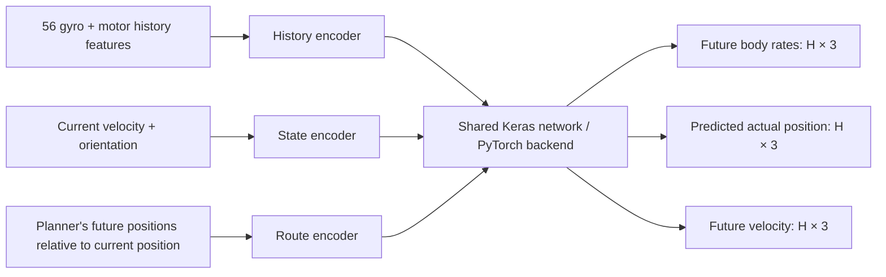

# Keras + PyTorch flight forecasting

The new pipeline uses **Keras 3's Functional API with PyTorch as its execution,
autograd and optimization backend**. It is one model, not separate Keras and
PyTorch predictions. `new_model.py` replaces the earlier unfinished scaffold.
The original NumPy experiments and their saved artifacts remain reproducible.

## What the model predicts

The existing 56 inputs are **8 chronological samples × 7 signals**:
`[gyro_x, gyro_y, gyro_z, motor_0, motor_1, motor_2, motor_3]`.
The three angular outputs are **body rates in rad/s**:
**roll about x, pitch about y, yaw about z**. These are not Euler angles,
position coordinates, or the individual motors' RPM.

Three rates alone cannot determine a route: two aircraft with identical angular
rates can have different positions and velocities. Integrating those rates does
not recover translational motion. The trajectory mode therefore adds current
state and an intended, time-parameterized route.



| Mode / config | Inputs | Outputs |
| --- | --- | --- |
| `keras-rates.json` | 56 history values | 3 rates, 50 ms ahead; tensor shape `(batch, 1, 3)` |
| `keras-trajectory.json` | 56 history values + velocity/quaternion + 10 planned xyz points | Three `(batch, 10, 3)` heads: rates, position, velocity, at 50, 100, …, 500 ms |

Current position is used as the origin for route offsets and to reconstruct
absolute position predictions, not as an absolute-coordinate learning feature.
The state encoder has seven values: three world-frame velocities and a unit
body-to-world quaternion. Quaternion signs are canonicalized. The default route
model thus uses 93 learned input scalars, not only 56, and produces 90 output
scalars. It directly predicts the horizon, without feeding its own predictions
back recursively. Horizons and network width are configurable.

The model learns residual corrections to persistent body rates/velocity and
constant-velocity position. Zero output initialization starts exactly at those
baselines. Input normalization and physical-unit residual scales come only from
training flights. Validation selects the epoch; epoch zero is eligible.
All heads receive equal weight after per-head residual scaling; this is a
development loss choice, not a calibrated flight-control error budget.

This predicts likely motion **conditional on the supplied plan and the training
aircraft/controller**. It does not choose an obstacle-free route or prove route
tracking. The existing A* planner chooses the intended route; its ideal trace
can be used as a desired plan only after explicit map-to-NED conversion and
time alignment. Do not use that ideal trace as measured aircraft dynamics.
There is no live planner/vehicle connection in this implementation. The
[ground-station exporter](GROUNDSTATION.md) sends observation-only forecasts to
the Rust recorder/dashboard using the shared JSONL contract.

## Run the rate model on existing logs

```sh
source .venv/bin/activate
python -m pip install -r requirements-neural.txt
python -m nn forecast-train \
  --dataset nn/data/idsia-native/causal-v1/dataset.json \
  --config nn/configs/keras-rates.json \
  --output nn/models/my-keras-rates

python -m nn forecast-replay \
  --model nn/models/my-keras-rates \
  --input nn/data/idsia-native/causal-v1/chirp_20251017_run1.csv \
  --output nn/results/my-keras-rates-replay.csv
```

`nn.new_model` selects `KERAS_BACKEND=torch` before importing Keras. If an
interactive process already imported Keras with another backend, restart it
with `KERAS_BACKEND=torch`; this pipeline rejects a different backend.

Training writes `model.keras`, `scaling.npz`, `model.json`, `validation.json`
and `training_history.csv`. Metadata records dependency versions, feature
order, offsets, training configuration, whole-flight split audit, dataset/code
hashes and artifact checksums. Existing output paths are never overwritten.

The current IDSIA recordings have already been exposed in previous development
experiments. Reusing their original train/validation roles does **not** create
a new untouched test. This training command does not score test flights.

### Saved run: `nn/models/keras-rates-v1`

Executed with Keras 3.15.1 / PyTorch 2.15.0 on CPU. The 1,923-parameter
56 → 32 → 3 model retained epoch 1 after seven epochs, using the original
square-flight training and chirp-flight validation assignment. On 22,627
validation windows, its rate MAE was **0.106826 rad/s**, versus **0.102096 rad/s**
for persistence. It does **not** establish an MAE improvement. Epoch selection
used normalized MSE, which differs from MAE. No final test was evaluated.
See `nn/models/keras-rates-v1/validation.json` for per-axis/per-flight scores.
This saved model predicts rates only; it is not a trained route model.

```sh
python -m nn forecast-evaluate \
  --dataset nn/data/idsia-native/causal-v1/dataset.json \
  --model nn/models/my-keras-rates --split validation \
  --output nn/results/my-keras-rates-validation.json
```

Explicit final-test scoring additionally requires `--split test
--acknowledge-test`. Reserve new recordings for a future final claim.
Reports include per-horizon/per-axis MAE, RMSE, 95th-percentile absolute error,
per-flight NN scores, persistence/constant-velocity baselines, and (for
trajectory mode) average/final displacement errors and a planned-route position
baseline. The network may be worse than a baseline; inspect the reports.

## Trajectory training data contract

Use the existing [CSV and whole-flight manifest contract](DATA_CONTRACT.md),
with these **additional columns in every flight CSV**:

| Columns | Meaning |
| --- | --- |
| `position_x_m`, `position_y_m`, `position_z_m` | Estimated local-world NED position: north, east, down, in metres |
| `velocity_x_m_s`, `velocity_y_m_s`, `velocity_z_m_s` | Velocity in that same NED frame, m/s; not body-frame velocity |
| `attitude_w`, `attitude_x`, `attitude_y`, `attitude_z` | Unit quaternion rotating body FRD vectors into world NED; wxyz order |
| `state_timestamp_us`, `state_valid` | Causal source timestamp and integer 0/1 validity for that state estimate |
| `plan_timestamp_us`, `plan_valid` | Plan's availability time and integer 0/1 validity |
| `plan_1_x_m`, `plan_1_y_m`, `plan_1_z_m`, …, `plan_10_z_m` | Intended world NED positions at this row's timestamp + the configured offsets |

State/motor/rate ages must be at most 15 ms by default; plan age at most 100 ms.
Negative/future ages, nonfinite states, bad quaternion norms, out-of-range
motors and timing gaps invalidate the affected windows. The horizon must have
valid measured rates and state labels. Future motor readings are never inputs.
Adjust timing limits deliberately to the actual log cadence; never invent
high-rate samples from slow position logs.

At **each anchor**, sample the version of the time-parameterized plan that was
already available at that anchor. Plan columns refer to `anchor + offset`, not
`plan_timestamp + offset`. Do not fill plan columns with future observed
positions or future setpoints that had not been issued yet. Merely assigning
an earlier timestamp does not make a future-derived plan causal.

Add this object under `contract.trajectory` in `dataset.json` for the default
trajectory configuration:

```json
{
  "world_frame": "NED",
  "position_units": "m",
  "velocity_units": "m/s",
  "attitude": "body_FRD_to_world_NED_quaternion_wxyz",
  "plan_offsets_us": [50000, 100000, 150000, 200000, 250000, 300000, 350000, 400000, 450000, 500000],
  "plan_semantics": "planned_positions_available_at_anchor_not_future_observations"
}
```

Record frame transformations, source clocks, sensors, autopilot configuration
and how plan availability was established in the manifest provenance. Hash the
completed CSV files and keep whole flight/session groups in one split, as in
the original contract. Rate-only CSVs fail with an explicit missing-trajectory
contract error; position labels are never fabricated.

```sh
python -m nn forecast-train \
  --dataset nn/data/your-route-logs/dataset.json \
  --config nn/configs/keras-trajectory.json \
  --output nn/models/your-route-forecaster
```

The existing canonical IDSIA import has only rates and motor commands. Native
HDF5 files also contain pose/odometry and setpoint fields, but a verified
world/body-frame mapping and a **future plan known at each anchor** have not
been established for this task. No real-data trajectory model has been trained.
The trajectory branch is verified with analytic test fixtures and a saved
synthetic demo model described in [GROUNDSTATION.md](GROUNDSTATION.md); this is
not demonstrated flight prediction accuracy. Predicting individual motor speeds would need a
separate measured-RPM target and validated motor mapping.

## Python inference

```python
from pathlib import Path
from nn.data import read_log
from nn.forecast import ForecastPredictor

predictor = ForecastPredictor(Path("nn/models/your-route-forecaster"))
snapshots = read_log(Path("your-flight.csv"))
future = predictor.predict_frame(snapshots.iloc[-8:].copy())
```

This returns one row per forecast horizon, with anchor/target timestamps,
`prediction_valid`, `outside_training_range`, and physical-unit predictions.
Invalid anchors have NaN predictions. Eight history rows are required; batch
replay skips the first seven warm-up rows. Range flags are not confidence
probabilities. The caller must enforce real-time freshness/timeout against its
current source clock: this offline API cannot detect silence or stale replay.

## Verification and Kaggle lead

```sh
python -m unittest discover -s nn/tests -v
```

Tests cover causal history/plan features, multi-step labels, future-state
validity, stale/future plans and states, timing, translation/quaternion-sign
invariance, train-only scaling, both Keras training modes, save/reload, offline
versus last-eight-snapshot parity, checksums, and explicit final-test access.
Test artifacts are created under `nn/` and automatically removed.

Reviewed the public metadata for
[kmader/drone-flight-path](https://www.kaggle.com/code/kmader/drone-flight-path)
on 2026-11-11. It lists the
[Drone Videos](https://www.kaggle.com/datasets/kmader/drone-videos) input dataset
and an Apache-2.0 notebook license. A
[mirrored dataset description](https://www.selectdataset.com/dataset/21e87af83e9912c834e54001bcbae959/drone-videos)
describes DJI Mavic Pro videos for vision/SLAM and says there are no ground-truth
labels. This is a possible vision/visualization reference, **not yet a verified
source of synchronized actuator/body-rate/known-plan labels**. Notebook cells
were not retrievable: Kaggle CLI is absent, direct access failed DNS resolution,
and browser access was unavailable. No Kaggle files were downloaded or used in
training. A successful `kaggle kernels pull kmader/drone-flight-path` downloads
notebook source, not automatically its input datasets.
